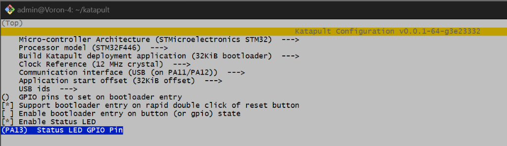
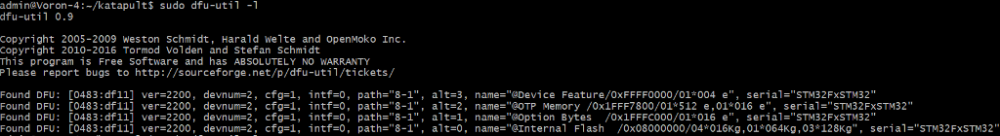

# 🚀 Мануал по развёртыванию хоста принтера (Alpaca 3D Farm)

Единая инструкция по поднятию нового или переустановленного хоста Klipper/Moonraker в парке **Alpaca 3D Farm**.  
Разделы **1–6** одинаковы для всех принтеров; отличия между **Voron 2.4** и **Ender-3 S1 Pro** вынесены в **раздел 7**.

---

## 🗺️ Карта парка

| Принтер | Hostname | IP | Платформа / Связь с MCU | Конфиг в репозитории |
| :--- | :--- | :--- | :--- | :--- |
| **Voron 2.4 (A)** | `ALP-VORON-A` | `10.10.10.51` | BTT CB1 / CAN `can0` (1 Mbps) | `ALP/voron/voron_a/` |
| **Voron 2.4 (B)** | `ALP-VORON-B` | `10.10.10.52` | BTT CB1 / CAN `can0` (1 Mbps) | `ALP/voron/voron_b/` |
| **Voron 2.4 (C)** | `ALP-VORON-C` | `10.10.10.53` | BTT CB1 / CAN `can0` (1 Mbps) | `ALP/voron/voron_c/` |
| **Voron 2.4 (D)** | `ALP-VORON-D` | `10.10.10.54` | BTT CB1 / CAN `can0` (1 Mbps) | `ALP/voron/voron_d/` |
| **Ender-3 S1 Pro (A)** | `ALP-ENDER-A` | `10.10.10.55` | Linux host / USB-Serial | `ALP/ender/common/` + A |
| **Ender-3 S1 Pro (B)** | `ALP-ENDER-B` | `10.10.10.56` | Linux host / USB-Serial | `ALP/ender/common/` + B |
| **Ender-3 S1 Pro (C)** | `ALP-ENDER-C` | `10.10.10.57` | Linux host / USB-Serial | `ALP/ender/common/` + C |

---

## 1. Образ ОС и первый вход

- Рекомендуемая ОС для BTT CB1: **Armbian / BIGTREETECH-CB1 `trixie`** (актуальные репозитории, Python 3.13, ядро `7.x`).
- При первом запуске создать пользователя **`aniki`**.
- Убедиться, что MAC-адрес привязан в DHCP (резервация на роутере под нужный IP `10.10.10.5x`).

### Добавление SSH-ключа (важно для новых ОС)
> На Debian 12/13 (`bookworm`/`trixie`) старый алгоритм `ssh-rsa` отключён по умолчанию — используйте **`ssh-ed25519`**.  
> Если в SSH-агенте (Bitwarden) много ключей, при первом входе по паролю добавьте `-o PubkeyAuthentication=no`, иначе сервер сбросит соединение с `Too many authentication failures`.

```powershell
ssh -p 22 -o PubkeyAuthentication=no aniki@<IP> "mkdir -p ~/.ssh && chmod 700 ~/.ssh && echo '<PUBLIC_ED25519_KEY>' >> ~/.ssh/authorized_keys && chmod 600 ~/.ssh/authorized_keys"
```

---

## 2. Hostname, `sudo` без пароля и SSH-порт `52122`

```bash
# 1. Имя хоста (заменить <HOSTNAME>, например ALP-VORON-B)
sudo hostnamectl set-hostname <HOSTNAME>
sudo sed -i 's/127\.0\.1\.1.*/127.0.1.1\t<HOSTNAME>/' /etc/hosts

# 2. sudo без пароля для aniki
echo 'aniki ALL=(ALL) NOPASSWD: ALL' | sudo tee /etc/sudoers.d/aniki > /dev/null
sudo chmod 440 /etc/sudoers.d/aniki
sudo visudo -cf /etc/sudoers.d/aniki

# 3. SSH-порт фермы 52122 (оставляя 22 на время настройки или постоянно)
printf "Port 22\nPort 52122\n" | sudo tee /etc/ssh/sshd_config.d/alp-port.conf > /dev/null
sudo sshd -t && sudo systemctl reload ssh
```

**Проверка:**
```bash
ssh -p 52122 aniki@<IP> "hostname && sudo -n -l | head -n 5"
```

---

## 3. Локали, обновление ОС и базовые пакеты

В некоторых образах Armbian в `/etc/locale.gen` раскомментированы все 500+ локалей — перед обновлением лучше оставить только нужные:

```bash
printf "C.UTF-8 UTF-8\nen_US.UTF-8 UTF-8\nru_RU.UTF-8 UTF-8\n" | sudo tee /etc/locale.gen > /dev/null
sudo locale-gen

sudo apt-get update && sudo apt-get upgrade -y
sudo apt-get install -y git curl wget can-utils python3-venv dfu-util gpiod
```

---

## 4. Доступ к GPIO без `root`

Чтобы Klipper / Moonraker / `gpiod` могли управлять пинами (реле питания, подсветка и т.д.) от пользователя `aniki`:

```bash
sudo groupadd -f gpio
sudo usermod -aG tty,dialout,sudo,video,netdev,input,render,gpio aniki

echo 'SUBSYSTEM=="gpio", KERNEL=="gpiochip[0-4]", GROUP="gpio", MODE="0660"' | sudo tee /etc/udev/rules.d/60-gpio.rules > /dev/null
sudo udevadm control --reload-rules
sudo udevadm trigger --action=add /dev/gpiochip0 /dev/gpiochip1
```

**Проверка:**
```bash
ls -l /dev/gpiochip*   # должно быть crw-rw---- root gpio
gpioinfo -c 0 | head -n 5
```

---

## 5. Профилактика фоновых обновлений (защита от обрыва печати)

Фоновые проверки `apt`, `unattended-upgrades` и особенно `fstrim` вызывают пики нагрузки CPU/I/O (`Timer too close` в Klipper) и могут приводить к ошибкам `mmc_erase` на некоторых SD-картах. Отключаем и маскируем:

```bash
sudo systemctl disable --now unattended-upgrades apt-daily.timer apt-daily-upgrade.timer fstrim.timer 2>/dev/null || true
sudo systemctl mask unattended-upgrades apt-daily.service apt-daily-upgrade.service apt-daily.timer apt-daily-upgrade.timer fstrim.service fstrim.timer

if [ -f /etc/apt/apt.conf.d/20auto-upgrades ]; then
  printf 'APT::Periodic::Update-Package-Lists "0";\nAPT::Periodic::Unattended-Upgrade "0";\n' | sudo tee /etc/apt/apt.conf.d/20auto-upgrades > /dev/null
fi
```

**Проверка:**
```bash
systemctl is-enabled unattended-upgrades apt-daily.timer apt-daily-upgrade.timer fstrim.timer
# Все 4 должны вывести: masked
```

---

## 6. Установка Klipper-стека и подключение репозитория

1. **Установка через KIAUH**:
   ```bash
   cd ~ && git clone https://github.com/dw-0/kiauh.git
   ./kiauh/kiauh.sh
   ```
   Установить: **Klipper**, **Moonraker**, **Mainsail** (включая `nginx`), **KlipperScreen** (если есть экран), при необходимости **Katapult** и **Crowsnest**.

2. **Подключение `alp-3d-firmware`**:
   ```bash
   cd ~
   git clone https://github.com/lexanikitin/alp-3d-firmware.git
   ln -s ~/alp-3d-firmware/ALP ~/printer_data/config/ALP
   ```

3. **Установка автосинхронизации при загрузке (`alp-firmware-sync.service`)**:
   ```bash
   sudo bash ~/alp-3d-firmware/ALP/ender/common/systemd/install_boot_sync.sh
   ```
   Скрипт автоматически настроит службу под пользователя `aniki`, создаст симлинк совместимости `~/alp-klipper-printers -> ~/alp-3d-firmware` и выполнит тестовый прогон.

---

## 7. Различия между линейками принтеров

### 🔷 Voron 2.4 350 (`voron_a` – `voron_d`)

1. **CAN-шина (`can0`, 1 Mbps)**:
   Проверить `/etc/network/interfaces.d/can0`:
   ```ini
   allow-hotplug can0
   iface can0 can static
       bitrate 1000000
       up ip link set $IFACE txqueuelen 1024
   ```
   Проверка: `ip -details link show can0` → `UP,LOWER_UP`, `bitrate 1000000`, `qlen 1024`, `ERROR-ACTIVE`.

2. **Конфигурация**:
   - Каждый Voron **полностью изолирован** в `ALP/voron/voron_<x>/` (разные CAN-платы, хотэнды, датчики).
   - Эталоны лежат в `ALP/voron/voron_<x>/reference/`:
     - `voron_<x>_printer.cfg` → `~/printer_data/config/printer.cfg`
     - `voron_<x>_moonraker.conf` → `~/printer_data/config/moonraker.conf`
     - `voron_<x>_My_Macros.cfg` → `~/printer_data/config/My_Macros.cfg`
   - В `printer.cfg` задаются индивидуальные `canbus_uuid` для `[mcu]` и `[mcu EBBCan]`.

3. **Установка и прошивка через Katapult** *(референс: `https://canbus.esoterical.online/mainboard_flashing.html`)*:
   - Зависимости и клонирование Katapult (на Debian 12/13 `trixie` лучше ставить `python3-serial` и `python3-can` через `apt`, чтобы не упереться в PEP 668):
     ```bash
     sudo apt-get install -y python3 python3-serial python3-can dfu-util
     test -e ~/katapult && git -C ~/katapult pull || git clone https://github.com/Arksine/katapult ~/katapult
     ```
   - **Первичная прошивка загрузчика Katapult на основную плату (пример: BTT Octopus PRO / STM32F446 через DFU)**:
     ```bash
     cd ~/katapult
     make menuconfig
     ```
     Параметры `Katapult Configuration`:
     - Micro-controller Architecture: `STMicroelectronics STM32`
     - Processor model: `STM32F446`
     - Build Katapult deployment application: `32KiB bootloader`
     - Clock Reference: `12 MHz crystal`
     - Communication interface: `USB (on PA11/PA12)`
     - Application start offset: `32KiB offset`
     - `[*] Support bootloader entry on rapid double click of reset button`
     - `[*] Enable Status LED` → `(PA13) Status LED GPIO Pin`

     

     Сохранить (`Save & Exit`) и собрать:
     ```bash
     make
     ```
     1. Замкнуть пины **BOOT** на плате (`BTT Octopus PRO`), подключить по USB и подать питание.
     2. Проверить наличие устройства в режиме DFU:
        ```bash
        sudo dfu-util -l   # Должно отобразиться устройство [0483:df11] STM32FxSTM32
        ```
        
     3. Прошить `katapult.bin`:
        ```bash
        sudo dfu-util -R -a 0 -s 0x08000000:leave -D ~/katapult/out/katapult.bin -d 0483:df11
        ```
     4. Снять перемычку BOOT, перезагрузить плату и двойным нажатием **RESET** войти в режим загрузчика Katapult — проверить появление serial-порта:
        ```bash
        ls /dev/serial/by-id/
        ```
   - **Прошивка Klipper на MCU по CAN через `flashtool.py`** (чтобы версии хоста и всех плат совпадали):
     ```bash
     sudo systemctl stop klipper
     ~/klippy-env/bin/python ~/katapult/scripts/flashtool.py -q
     ~/klippy-env/bin/python ~/katapult/scripts/flashtool.py -i can0 -u <CANBUS_UUID> -f ~/klipper/out/klipper.bin
     sudo systemctl start klipper
     ```

4. **Host MCU (`klipper-mcu.service` для `[mcu host]`)**:
   ```bash
   cd ~/klipper/
   sudo cp ~/klipper/scripts/klipper-mcu.service /etc/systemd/system/
   sudo systemctl enable klipper-mcu.service
   make menuconfig
   # В меню выбрать: Microcontroller Architecture -> Linux process, затем Save & Exit
   sudo service klipper stop
   make flash
   sudo service klipper start
   ```
   Проверка: `systemctl is-active klipper-mcu.service` → `active`.

---

### 🔶 Creality Ender-3 S1 Pro (`ender_a` – `ender_c`)

1. **Связь с MCU**:
   - Подключение по USB-Serial (`/dev/serial/by-id/...`), интерфейс `can0` **не используется**.

2. **Конфигурация (единое ядро)**:
   - Все 3 станка используют **общее ядро** `ALP/ender/common/` (hardware, macros, KAMP, Demon Essentials).
   - В `~/printer_data/config/printer.cfg` допустимы только индивидуальные калибровки железа:
     - `[mcu] serial: /dev/serial/by-id/...`
     - `[bltouch] z_offset`
     - PID стола и экструдера
     - `[extruder] rotation_distance`
   - Конфиг Moonraker: `ALP/ender/ref_moonraker.conf` → `~/printer_data/config/moonraker.conf`.

3. **Прошивка MCU**:
   - Сборка `klipper.bin` под контроллер Ender-3 S1 Pro и прошивка с SD-карты (в корне в папке `STM32F4_UPDATE/`).

---

## ✅ Чек-лист приёмки хоста

- [ ] `ssh -p 52122 aniki@<IP>` работает по ключу, `sudo -n -l` без пароля
- [ ] `hostname` соответствует `ALP-<MODEL>-<LETTER>`
- [ ] `systemctl is-enabled unattended-upgrades apt-daily.timer apt-daily-upgrade.timer fstrim.timer` → все `masked`
- [ ] `gpioinfo -c 0` работает от `aniki` без `sudo`
- [ ] Mainsail открывается по `http://<IP>/`, Klipper и Moonraker `active`
- [ ] `systemctl is-enabled alp-firmware-sync.service` → `enabled`
- [ ] В `Moonraker Update Manager` репозиторий `alp-3d-firmware` отображается с `"is_valid": true`
